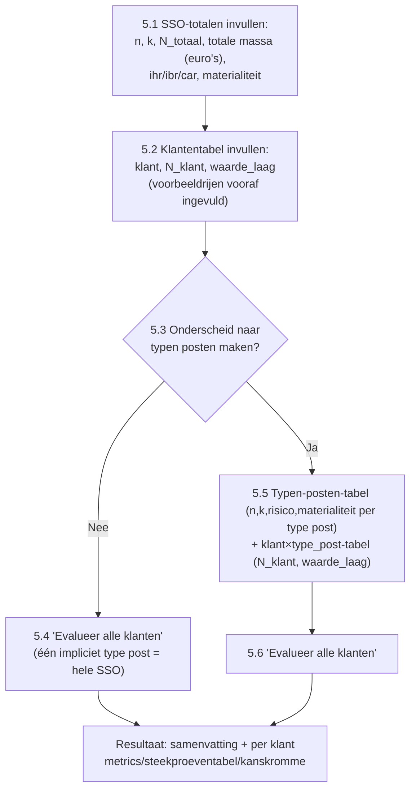

# SSO-tab herontwerp: geleide flow, theoretische achtergrond, methodekeuze, consistentiechecks

Aanleiding: eerste gebruikerssessie met de live Streamlit-app leverde vijf verbeterpunten op.
Dit plan werkt ze uit tot concrete, afgebakende implementatiestappen.

## Beslissingen uit het ontwerpgesprek (vastgelegd, niet opnieuw ter discussie)

1. **Lean-bewijs:** nu niet bouwen. Alleen de wiskundige afleiding tonen (gewone notatie/LaTeX
   in de app); Lean wordt pas in een latere slag opgepakt.
2. **Theoretische achtergrond:** zowel een apart overzichtstabblad "Theorie/Achtergrond" als
   contextuele `st.expander`-uitklappers bij de relevante stappen in de werktabbladen.
3. **Voorbeeldinvoer:** tabellen starten gevuld met realistische voorbeeldcijfers, duidelijk
   gelabeld als voorbeeld (bijv. "voorbeelddata — overschrijf dit"), die de gebruiker overtypt
   of verwijdert. Geen per-cel ghost-text (technisch niet haalbaar in `st.data_editor`).
4. **Consistentiechecks:** (a) som van `N_klant`/`waarde_laag` over klanten (5.2) moet gelijk
   zijn aan de SSO-brede totalen (5.1); (b) bij onderscheid naar typen posten (5.5): som over
   typen posten per klant moet gelijk zijn aan de klant-totaalregel uit 5.2, én som van `n`/`k`
   over typen posten moet gelijk zijn aan het SSO-brede `n`/`k` uit 5.1.
5. **Berekeningsmethoden:** drie keuzes — (a) naïeve pooling-benadering, (b) huidige
   momentmatching-methode (`moment_match_SSO`, ongewijzigd default), (c) nieuwe FFT-exacte
   methode: directe convolutie van de twee-traps posterior per klant, zonder de
   Beta/Gamma-benadering van `moment_match_SSO` als tussenstap.
6. **(n,k) per type post bij onderscheid:** gebruiker vult dit apart in per type post (zoals nu
   al in `sso_typen_posten_tabel`); de SSO-brede (n,k) uit 5.1 dient dan als controlegetal
   (consistentiecheck 4b), niet als afgeleide bron.

## Nieuwe geleide flow (vervangt het huidige "meteen twee tabellen"-scherm)

Dit is een **additieve voorkant** op de bestaande architectuur: de huidige twee tabellen
(`sso_typen_posten_tabel`, `sso_klanten_tabel`) en de aanroep van
`evalueer_SSO_klant_gestratificeerd` blijven bestaan en worden gebruikt zodra de gebruiker voor
"Ja" bij 5.3 kiest. Nieuw zijn: het 5.1-totalenblok, de vereenvoudigde 5.2-klantentabel (zonder
`type_post`-kolom), de 5.3-keuzeknop/radio, en het "geen onderscheid"-pad (5.4) dat één
synthetisch type post ("totaal") met de SSO-brede (n,k) en per-klant (N_klant, waarde_laag) uit
5.2 door de bestaande pijplijn haalt.

**Opmerking/aanname die ik aan je voorleg:** voor consistentiecheck 4a (`N_klant`-sommen) is een
SSO-breed totaalaantal posten nodig. Je noemde in 5.1 alleen *n, k, totale massa in geld* — ik
voeg daarom een vierde veld `N_totaal` (totaal aantal posten in de SSO) toe aan 5.1, puur om deze
check mogelijk te maken. Zeg het als dat niet de bedoeling is.

## Implementatiestappen

### Stap 1 — Theoretische achtergrond (laagste risico, geen backend-wijziging)
- Nieuw tabblad "Theorie" met secties (elk met wiskundige afleiding in LaTeX/`st.latex`):
  two-stage sampling (idee + waarom twee lagen), de naïeve `n_klant`-poolingformule (afleiding
  en waarom ze te conservatief/optimistisch kan zijn, verwijzend naar de bestaande
  AGENTS.md-analyse), momentmatching (gemiddelde+variantie-kalibratie, Var(X)≤p(1-p)), en (zodra
  stap 4c klaar is) de FFT-exacte convolutie.
- Contextuele `st.expander("Hoe werkt dit?")` bij: de modelkeuze (binomiaal/poisson), de
  typen-posten-tabel, de klantentabel, en de methodekeuze — elk met een korte samenvatting plus
  een verwijzing ("zie tabblad Theorie voor de volledige afleiding").
- Geen wijziging aan `auditstat`-pakketcode; puur `app.py` + nieuwe statische tekst/LaTeX.

### Stap 2 — Voorbeeldinvoer in tabellen
- `LEGE_SSO_TYPEN_POSTEN_DF` en `LEGE_SSO_KLANTEN_DF` (en mogelijk ook de eval-/plan-tabellen,
  ter overweging) vullen met realistische voorbeeldcijfers i.p.v. lege rijen.
- Duidelijk label erboven ("onderstaande cijfers zijn een voorbeeld — overschrijf of verwijder
  ze") zodat niemand per ongeluk met voorbeelddata rekent zonder het te beseffen.
- Geen wijziging aan validatielogica nodig: voorbeelddata moet zelf aan alle bestaande checks
  voldoen.

### Stap 3 — Consistentiechecks
- Nieuwe hulpfunctie(s) in `app.py` die, ná elke tabelwijziging of vóór het klikken op
  "evalueer", de vier sommen (4a ×2, 4b ×2) berekenen en bij afwijking (buiten een kleine
  afrondingstolerantie) een waarschuwing tonen — vermoedelijk `st.warning`, niet hard blokkerend
  zoals de bestaande celvalidatie (dit zijn totaalconsistenties over meerdere rijen/tabellen
  heen, niet een enkele-celfout).
- Te beslissen bij implementatie: wel/niet blokkeren van de berekening bij inconsistentie, of
  alleen waarschuwen en toch doorrekenen (ter bevestiging bij start van deze stap).

### Stap 4 — Berekeningsmethoden
- **4a. Naïeve pooling-benadering:** nieuwe, duidelijk als "approximatie" gelabelde
  backend-functie (bijv. `auditstat/sso/naief_SSO.py`) die `n_klant = n·N_klant/(n+N_klant)`
  toepast en een resultaat-dict teruggeeft dat qua vorm compatibel is met wat
  `plot_kanskromme`/de resultatensectie verwacht (`max_fout_convolutie`,
  `max_fout_convolutie_geld`, `steekproeven`, `kanskromme` met `x`/`y`).
- **4b. Momentmatching:** ongewijzigd, blijft de default.
- **4c. FFT-exact:** nieuwe module die, zonder de Beta/Gamma-tussenstap van
  `moment_match_SSO`, de voorspellende verdeling van de klant-foutfractie direct via
  FFT-convolutie van de twee-traps posterior opbouwt. Dit is het zwaarste onderdeel van dit
  plan — vereist eigen statistisch ontwerp (welke exacte posterior, welk rooster, hoe dit per
  type post samenvoegen tot een gestratificeerd klantresultaat). **Voorstel: dit als eigen
  deelontwerp behandelen zodra stappen 1–3 en 4a/4b staan**, met een korte aparte
  ontwerpronde (vergelijkbaar met de momentmatching-kalibratie-discussies in AGENTS.md) vóór
  implementatie — niet in één keer meebouwen met de UI-herstructurering.
- UI: een `st.radio`/`st.selectbox` "berekeningsmethode" in het instellingenblok van de SSO-tab,
  naast de bestaande model-/zekerheidskeuze.

### Stap 5 — Geleide flow in de SSO-tab
- Herstructureer `with tab_sso:` naar de flow hierboven: 5.1-invoervelden (los van de tabellen),
  vereenvoudigde 5.2-klantentabel (nieuwe sessiestatus, aparte van de bestaande
  `sso_klanten_tabel` die nu `type_post` bevat), een keuzeradio voor 5.3, en conditioneel tonen
  van de bestaande typen-posten-/klant×type_post-tabellen (5.5) alleen als "Ja" gekozen is.
- Submitlogica: bij "Nee" (5.4) bouwt de app zelf één `post_typen`-rij per klant (naam "totaal",
  met de SSO-brede n/k/risico/materialiteit uit 5.1 en de N_klant/waarde_laag uit 5.2) en roept
  `evalueer_SSO_klant_gestratificeerd` daarmee aan — geen wijziging aan de backend nodig voor dit
  pad.
- Bij "Ja" (5.5/5.6): huidige logica blijft grotendeels intact, met de consistentiechecks (stap 3)
  erbovenop.
- Sessiestatus: nieuwe keys voor de 5.1-velden en de vereenvoudigde 5.2-tabel; bestaande
  `sso_typen_posten_tabel`/`sso_klanten_tabel`-keys blijven voor het 5.5-pad.

## Volgorde van bouwen (voorstel)

1. Stap 1 (theorie) en stap 2 (voorbeeldinvoer) — onafhankelijk, laag risico, kunnen gelijktijdig.
2. Stap 5 (geleide flow) mét alleen methode (b) momentmatching — dit is de kernherstructurering.
3. Stap 3 (consistentiechecks) bovenop de nieuwe flow.
4. Stap 4a (naïeve methode) — kleine, zelfstandige toevoeging aan de methodekeuze.
5. Stap 4c (FFT-exact) — eigen deelontwerpronde, apart traject, los van de rest.

Elke stap wordt los gecommit/getest (`pytest`, `ruff`) zoals gebruikelijk in dit project.

## Open vraag voor bevestiging

- Akkoord met het toevoegen van `N_totaal` aan 5.1 (zie opmerking hierboven)?
- Akkoord met de voorgestelde bouwvolgorde (theorie/voorbeelden → geleide flow →
  consistentiechecks → naïeve methode → FFT-exact als apart vervolgtraject)?
