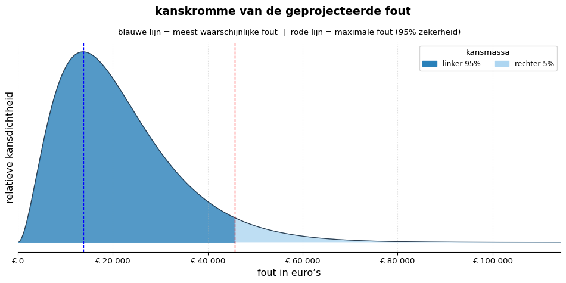

# README auditstratified


# Inleiding

Het doel van het **auditstratified**-pakket is om de totale foutfractie
van een aantal geldmassa’s te schatten gebaseerd op steekproeven. De
aanname is dat er geen samenhang in foutkans is tussen de afzonderlijke
steekproeven. Elke afzonderlijk gecontroleerde massa heet een
**stratum**; bij elkaar gaat het om meerdere **strata**. Een combinatie
van meerdere steekproeven noemen we een **gestratificeerde steekproef**.

Het pakket bevat drie hoofdfuncties:

- `plan_stratified()` — plannen van steekproeven, dit is bepalen hoeveel
  steken per massa nodig zijn;
- `eval_stratified()` — gezamenlijke evaluatie van meerdere
  steekproeven, dit is schatten van de foutfractie per massa en schatten
  van de totale foutfractie;
- `plot_kanskromme()` — visualisatie van de resulterende kansverdeling.

Bij planning en evaluatie van de steekproeven wordt gebruik gemaakt van
risico-inschattingen per stratum door de auditor. De gebruikte manier
van risico-inschatting sluit aan bij de voorschriften voor gebruik van
steekproeven voor auditing conform het HARo (Handboek Auditing
Rijksoverheid). Het HARo beschrijft ook hoe de risico-inschattingen
worden vertaald naar statistische onzekerheid.

Hoewel in de auditpraktijk doorgaans eerst wordt gepland en daarna
geëvalueerd, bespreken we hieronder eerst `eval_stratified()`. De
werking van `plan_stratified()` wordt namelijk het duidelijkst begrepen
vanuit de evaluatiemethode.

# Kenmerken

- **Gestratificeerd plannen:** Berekent een kostenefficiënte
  steekproefverdeling over meerdere strata waarbij rekening wordt
  gehouden met verschillen in controle-inspanning.
- **Kostenefficiënt plannen:** Het algoritme weegt de verwachte
  foutreductie af tegen de uitvoeringskosten per steekproef, waardoor
  verschillen in controlekosten worden meegewogen.
- **Meerdere convolutierekenmethoden voor schatten:** Voegt
  foutkansverdelingen van afzonderlijke steekproeven samen via vier
  verschillende methoden: directe convolutie, FFT paarsgewijs, FFT samen
  en Monte Carlo.
- **HARo-gebaseerd:** Zekerheid afgeleid van IHR, IBR en CAR volgens het
  Handboek Auditing Rijksoverheid.
- **Gevectoriseerd en snel:** Gebouwd op Pandas, NumPy en SciPy voor
  goede rekenprestaties.

# Demo

Probeer de live auditstratified app
[**hier.**](https://auditstratifiedp-ko3vmnx8pfjkuf8xacb8kx.streamlit.app/)

# Installatie

<!--
Dit vertellen we even niet, omdat ik het zelf nauwelijks snap, en
het vooral reclame voor Google Colab lijkt.
&#10;## In de cloud
&#10;Maak bijvoorbeeld een [**leeg Google Colab-notebook**](https://colab.research.google.com/) aan en plak
dit in de eerste cel:
&#10;  !git clone https://GitHub.com/cfjdoedens/auditstratifiedp.git
  !pip install -r auditstratifiedp/requirements.txt
&#10;  import sys
  sys.path.append('/content/auditstratifiedp')
&#10;Vervolgens kun je de functies direct gebruiken.
-->

### Voor lokaal gebruik

Dit voer je in in je terminalvenster waarin bash, of een vergelijkbare
Linux/Unix shell draait.

``` bash
pip install git+https://GitHub.com/cfjdoedens/auditstratifiedp.git
```

### Voor ontwikkeling (broncode lokaal):

Dit voer je in in je terminalvenster waarin bash, of een vergelijkbare
Linux/Unix shell draait.

``` bash
git clone https://GitHub.com/cfjdoedens/auditstratifiedp.git
cd auditstratifiedp
pip install -e .
```

Het pakket bevat tests om het pakket te valideren:

- Functionele tests, met onder meer praktijkgevallen.
- Tests of de verschillende convolutiealgoritmen dezelfde uitkomst
  geven.
- Tests of de uitkomsten zijn zoals eerder berekend.

Om de tests (150+ stuks) uit te voeren:

``` bash
python -m pytest
```

# GitHub

Zie [de GitHub-pagina van het
project](https://GitHub.com/cfjdoedens/auditstratifiedp) voor de code.

# Twee statistische modellen: binomiaal en Poisson

De planning en evaluatie van de strata gebeurt ofwel met het binomiale
model ofwel met het Poissonmodel.

- Binomiaal. Het meest nauwkeurige van de twee modellen. De foutfractie
  is hierbij, overeenkomstig de werkelijkheid, begrensd tussen 0 en 1.
- Poisson. Een traditionele benadering van het binomiale model die veel
  wordt gebruikt binnen de auditpraktijk. De benadering is vooral
  nauwkeurig bij kleine foutfracties. Bij hogere foutfracties neemt de
  afwijking ten opzichte van het binomiale model toe. Bovendien kent het
  Poissonmodel geen natuurlijke bovengrens van 1 voor de foutfractie.

# Keuze voor convolutie

Convolutie is de wiskundige bewerking waarmee onafhankelijke
kansverdelingen worden gecombineerd. Uit de resulterende gecombineerde
kansverdeling kunnen vervolgens onder andere de minimale en maximale
fout bij een gekozen zekerheidsniveau worden afgeleid.

`eval_stratified` gebruikt convolutie omdat daarmee de statistische
onzekerheid van de afzonderlijke strata gezamenlijk kan worden
gemodelleerd, in plaats van bijvoorbeeld de maximale fouten van de
afzonderlijke strata simpelweg bij elkaar op te tellen.

# Vier rekenmethoden voor convolutie

auditstratified ondersteunt vier verschillende algoritmen om de
convolutie uit te voeren. Waarom vier? Vooral om het vertrouwen in de
uitkomst te verhogen: elk van de methoden levert — afgezien van kleine
rekenkundige verschillen en statistische ruis bij Monte Carlo —
hetzelfde resultaat op.

1.  Direct. Numerieke benadering waarbij de foutas wordt verdeeld in
    kleine stukjes, zeg een raster. Kanskrommen worden vervolgens
    paarsgewijs gecombineerd.

2.  FFT paarsgewijs. Ook gebaseerd op een raster, maar maakt gebruik van
    een Fast Fourier Transform (FFT). De kanskrommen worden hierbij
    omgezet in een frequentieverdeling ter combinatie. Kanskrommen
    worden paarsgewijs gecombineerd.

3.  FFT samen. Alle kanskrommen worden op één gezamenlijk raster
    geplaatst en samen gecombineerd. Dit is de aanbevolen
    standaardmethode binnen auditstratified.

4.  Monte Carlo. De gecombineerde verdeling wordt opgebouwd door een
    groot aantal willekeurige trekkingen uit de afzonderlijke
    kanskrommen.

De wijze van berekenen wordt beïnvloed door de parameter
`granulariteit`:

- bij de eerste drie methoden: bepaalt granulariteit het aantal
  rasterpunten;
- bij Monte Carlo: bepaalt granulariteit het aantal simulaties.

Een hogere granulariteit leidt tot een nauwkeuriger resultaat, maar
verhoogt de rekentijd.

De eerste drie methoden vormen feitelijk een reeks steeds efficiëntere
algoritmen:

    Direct → FFT paarsgewijs → FFT samen

`FFT samen` is doorgaans zowel het snelst als het meest stabiel. De
Monte Carlo-methode introduceert statistische ruis doordat
toevalsgetallen worden gebruikt.

Bij `eval_stratified()` kan worden gekozen tussen alle vier methoden.
Bij `plan_stratified()` wordt altijd gebruikgemaakt van **FFT samen**.

------------------------------------------------------------------------

# `eval_stratified()`: Evaluatie van meerdere steekproeven

`eval_stratified()` combineert meerdere afzonderlijke steekproeven tot
één gezamenlijke evaluatie.

Dit is nuttig wanneer een totale populatie bestaat uit verschillende
deelpopulaties, bijvoorbeeld:

- verschillende locaties;
- verschillende systemen;
- verschillende processen.

Wanneer resultaten simpelweg zouden worden opgeteld, wordt de
statistische onzekerheid onjuist behandeld.

`eval_stratified()` lost dit op door:

1.  voor ieder stratum een kansverdeling op te bouwen;
2.  deze kansverdelingen via convolutie samen te voegen;
3.  uit de gecombineerde verdeling een minimale en maximale foutfractie
    af te leiden.

## Verfijning: Hoogstratum en Laagstratum

In de praktijk bevatten bestanden soms grote posten die integraal (100%)
worden gecontroleerd. `auditstratified` maakt onderscheid tussen:

1.  Laagstratum. De populatie waaruit daadwerkelijk een steekproef wordt
    getrokken. De resultaten worden geëxtrapoleerd.

2.  Hoogstratum Grote posten die integraal (100%) worden gecontroleerd.
    Deze worden niet geëxtrapoleerd.

## Algoritme

Binnen ieder laagstratum worden de aangetroffen gehele en fractionele
fouten opgeteld. Deze som wordt aangeduid met `k_laag`; het aantal
getrokken posten met `n_laag`. Op basis van `k_laag`, `n_laag` en het
gekozen statistische model wordt vervolgens de kansverdeling van de
foutfractie in dat laagstratum bepaald.

Vervolgens worden de kanskrommen van de verschillende strata
gecombineerd met convolutie tot 1 kanskromme over de foutfractie van al
het geld van de laagstrata samen.

De hoogstrata worden *niet* statistisch geëvalueerd. Dat is namelijk
niet nodig, aangezien ze uitputtend zijn onderzocht. Er is geen
onzekerheid meer voor de hoogstrata. Het als fout bestempelde geld, het
foutgeld, in alle hoogstrata wordt bij elkaar opgeteld. En vervolgens
toegevoegd aan de kanskromme van het geld uit de laagstrata.

## Speciale gevallen

De volgende speciale gevallen zijn op zich mogelijk interessant, en
geven ook meer inzicht in hoe `eval_stratified()` werkt.

### Scenario 1: Geen fouten in het hoogstratum; het verdunningseffect

Er zijn twee steekproeven. Beide bevatten fouten in het laagstratum,
maar geen fouten in de integraal gecontroleerde posten.

#### Effect

De foutloze hoogstrata vergroten de totale populatieomvang zonder extra
fouten toe te voegen. Daardoor daalt de uiteindelijke foutfractie: het
verdunningseffect.

### Scenario 2: Wel fouten in het hoogstratum; geen projectie

Er zijn twee steekproeven, beide hebben een niet-leeg hoogstratum. Stel,
hoogstratum 1 bevat € 15.000 fout, hoogstratum 2 bevat € 5.000 fout.

#### Effect

De kanskrommen voortkomend uit de verschillende laagstrata worden
gecombineerd door middel van convolutie. Vervolgens worden de € 20.000
aan geconstateerde fouten rechtstreeks toegevoegd aan de uitkomst,
zonder onterechte extra statistische opslag. Anders gezegd, er vindt
geen projectie van de foutfractie van de posten uit het hoogstratum
plaats, de fouten in het hoogstratum tellen voor zichzelf.

### Scenario 3: Volledige populatie gecontroleerd; bestand wordt geheel beschouwd als hoogstratum

Stel, er zijn meerdere strata. 1 van die strata wordt volledig
gecontroleerd en bevat € 12.500 aan fouten.

#### Effect

Er is geen statistische onzekerheid meer voor dit bestand. Geef voor het
laagstratum een omvang van € 0 op; het bestand kan worden behandeld als
één volledig gecontroleerd hoogstratum, met daarin € 12.500 aan fout
geld. Het lege laagstratum wordt door `eval_stratified()` niet
meegenomen in de convolutie.

## Risicofactoren en materialiteit

Binnen de Rijksoverheid wordt de vereiste statistische zekerheid van een
steekproef bepaald via het Audit Risk Model (ARM), zoals voorgeschreven
in het Handboek Auditing Rijksoverheid (HARo). Dit handboek is in beheer
bij de Auditdienst Rijk (ADR). Het ARM berekent de benodigde zekerheid
op basis van drie kenmerken van de te controleren populatie: het
Inherent Risico (IHR), het Interne Beheersingsrisico (IBR) en het
Cijferanalyserisico (CAR). Elk van IHR, IBR en CAR kan een van de
waarden, hoog, midden of laag hebben.

Staan al deze risicofactoren op hoog, dan leunt de accountant volledig
op de steekproef en is er bijvoorbeeld 95% zekerheid nodig. Is het IBR
laag (bijvoorbeeld door een sterke interne controle), dan mag de
vereiste zekerheid uit de steekproef omlaag (bijv. naar 64%).

Het HARo hanteert een tabel die de statistische interpretatie van de
risicowaarden hoog, midden en laag voor IHR, IBR en CAR beschrijft. De
vereiste zekerheid bepaalt, in combinatie met de vastgestelde
materialiteit (de maximaal acceptabele fout in de populatie), hoeveel
posten er fysiek getrokken moeten worden. Bij een lager risico is de
steekproefomvang kleiner.

## Virtuele foutloze posten: nogmaals risicofactoren en materialiteit

Het kan handig zijn, zoals we zometeen zullen zien, om het feit dat er
een verlaagd risico is op fouten in een stratum te vertalen naar alsof
er voorafgaand aan de eigenlijke steekproef al een aantal posten zijn
getrokken, en dat we geconstateerd hebben dat die posten foutloos zijn.
Zo’n aantal posten noemen we **virtuele foutloze posten**. Je fysieke
steekproefomvang wordt door het verlaagde risico weliswaar kleiner, maar
wiskundig gezien wordt jouw bewijslast ‘aangevuld’ door de virtuele
foutloze posten die voortkomen uit je positieve risicoanalyse. Je kunt
dit zien alsof, bijvoorbeeld in geval van een verlaagde IBR, de interne
systemen vooraf al een aantal posten foutloos voor je hebben
gecontroleerd.

Bij de berekening van het aantal virtuele foutloze posten moeten we niet
alleen rekening houden met de geconstateerde waarden voor IHR, IBR en
CAR, maar ook met de materialiteit: de toegestane foutfractie in de te
controleren massa. We noemen het aantal virtuele foutloze posten dat
overeenkomt met IHR+IBR+CAR+materialiteit ook wel het
**foutlozepostenequivalent**. Het foutlozepostenequivalent wordt
berekend als `omvangzondervoorkennis` - `omvangmetvoorkennis`.

Hier is `omvangzondervoorkennis` het aantal posten minimaal nodig om
vast te stellen met 95% zekerheid dat de fout in de te controleren massa
onder de materialiteit ligt. 95% is de zekerheid, geëist door het HARo,
dat de uitspraak gedaan door de auditor juist is. Bij de berekening gaan
we er vanuit dat er geen fouten in de te controleren massa zitten (dus
dat de kans dat we een foute post aantreffen 0 is, maar we moeten dat
nog steeds wel bewijzen door de steekproef).

`omvangmetvoorkennis` wordt op dezelfde wijze berekend met het verschil
dat we geëiste zekerheid afslaan volgens het HARo op basis van IHR, IBR
en CAR.

## Verschillende steekproeven combineren via harmonisatie

Dit concept vormt het wiskundige fundament onder auditstratified bij het
combineren van verschillende steekproeven:

    Steekproef A (Hoog risico): Vereist 95% zekerheid. Er is
    geen steun op interne controles, dus er zijn 0 virtuele posten.
    Het benodigde bewijs moet 100% uit de getrokken posten komen.
    Steekproef B (Laag risico): Vereist slechts 64% zekerheid.
    De sterke interne controle levert een flinke buffer aan virtuele
    foutloze posten op. Er hoeven fysiek veel minder posten getrokken te worden.

Als je de resultaten van Steekproef A en B wilt samenvoegen, kun je niet
zomaar de gevonden fouten en getrokken aantallen bij elkaar optellen;
het statistische vertrekpunt is immers ongelijk.

auditstratified lost dit op door bij de evaluatie voor élke
afzonderlijke steekproef het totale bewijs te harmoniseren (fysiek
getrokken posten + virtuele foutloze posten op basis van de opgegeven
IHR/IBR/CAR-parameters en materialiteit). Na toevoeging van deze
virtuele posten past het package de convolutie toe. Hierdoor weegt de
vooraf verkregen zekerheid per bestand mee in de berekende maximale fout
voor de gehele populatie.

## Invoerdata eval_stratified

`eval_stratified()` verwacht 7 argumenten.

1.  een `pandas.DataFrame` waarin iedere rij één steekproef
    vertegenwoordigt.
2.  het model: “binomiaal” of “poisson”; bij verstek “binomiaal”
3.  de gewenste zekerheid; bij verstek 0,95, dus 95%.
4.  de methode: “FFT paarsgewijs”, “FFT samen”, “direct” of “Monte
    Carlo”, verstekwaarde “FFT samen”.
5.  granulariteit; verstekwaarde bij Monte Carlo 10.000.000, anders
    100.000.
6.  start: de startwaarde van de toevalsgenerator, alleen van belang
    voor methode Monte Carlo. Bij verstek 1.
7.  vergelijk: een bool. Als `True` bereken ter vergelijking de maximale
    en minimale fout via een paar grove benaderingen.

### Kolommen invoerdataframe

| Kolom           | Beschrijving                                   | Beschrijft  |
|-----------------|------------------------------------------------|-------------|
| `naam`          | Naam van het stratum                           | Algemeen    |
| `waarde_laag`   | Totale boekwaarde laagstratum                  | Laagstratum |
| `n_laag`        | Aantal gecontroleerde posten laagstratum       | Laagstratum |
| `k_laag`        | Som van de gevonden foutfracties               | Laagstratum |
| `ihr`           | Inherent risico (`H`, `M`, `L`)                | Risico      |
| `ibr`           | Intern beheersingsrisico (`H`, `M`, `L`)       | Risico      |
| `car`           | Cijferanalyserisico (`H`, `M`, `L`)            | Risico      |
| `waarde_hoog`   | Totale waarde integraal gecontroleerde posten  | Hoogstratum |
| `fout_hoog`     | Geconstateerde fout in euro’s                  | Hoogstratum |
| `materialiteit` | Materialiteit als fractie van het hele stratum | Risico      |

# `plan_stratified()`: Plannen van meerdere steekproeven

`plan_stratified()` zoekt met een iteratief algoritme naar een
kostenefficiënte verdeling van de steekproefomvang over de strata,
zodanig dat de gezamenlijke maximale fout onder de algehele
materialiteit blijft.

## Algoritme

Het planningsalgoritme is gebaseerd op het evaluatie-algoritme. We
gebruiken een **heuvelklimalgoritme** dat stap voor stap
steekproefposten toevoegt aan de strata, waarbij steeds koers wordt
gehouden door `eval_stratified()` aan te roepen. In pseudocode:

    while eval_stratified(strata) > totale_materialiteit:
       bepaal voor welk stratum de maximale fout het meest afneemt
       per kosteneenheid als n voor dat stratum met 1 wordt opgehoogd;
       hoog n voor dat stratum op

Bij een gelijkstand (twee of meer strata leveren dezelfde foutreductie
per kosteneenheid) worden alle ex-aequo strata tegelijk opgehoogd.

## Invoerdata plan_stratified

`plan_stratified()` verwacht 5 argumenten.

1.  een `pandas.DataFrame` waarin iedere rij één steekproef
    vertegenwoordigt.
2.  het model: “binomiaal” of “poisson”; bij verstek “binomiaal”
3.  materialiteit: de totale materialiteit over alle steekproeven heen
4.  de gewenste zekerheid; bij verstek 0,95, dus 95%.
5.  granulariteit; verstekwaarde is 10.000.

De parameter `methode`, die wordt gebruikt bij `eval_stratified()`, is
niet nodig. `plan_stratified()` gebruikt als methode altijd “FFT samen”.
Daarom is de parameter `start` voor de startwaarde van de
toevalsgenerator ook niet nodig, want die wordt alleen gebruikt bij de
methode “Monte Carlo”.

Het gebruikte pandas DataFrame bevat de kolom `kosten`. Dit zijn de
relatieve kosten van een enkele steek per steekproef. Dus als er
bijvoorbeeld twee steekproeven zijn te plannen, eentje voor salarissen
en eentje voor subsidies en de kosten per steek zijn voor de subsidies
15 keer zo hoog als voor de salarissen, dan geef je als waarde voor de
kosten voor de salarissen 1 mee, en voor de subsidies 15.

# `plot_kanskromme()`: Visualisatie van de kanskromme

Gebruik `plot_kanskromme()` om de resulterende kansverdeling te
visualiseren. De grafiek toont onder andere:

- de meest waarschijnlijke fout;
- de maximale fout;
- de minimale fout;
- de kansverdeling.

# Aan de slag: een voorbeeld

> **Let op — getalnotatie in Python-code** Python vereist altijd een
> **punt** als decimaalteken in getallen (`0.03`, niet `0,03`). `0,03`
> is in Python een tuple, geen getal, en geeft een fout. Dit geldt voor
> alle directe functieaanroepen en DataFrame-waarden in code. De
> interactieve app gebruikt wél Europese notatie (komma als
> decimaalteken).

## 1. Plannen

`plan_stratified()` berekent een kostenefficiënte steekproefverdeling,
waarbij stapsgewijs de steek wordt toegevoegd die op dat moment de
grootste foutreductie per kosteneenheid oplevert om zo uiteindelijk
onder de gestelde algehele materialiteit te komen.

Als auditstratified nog niet lokaal is geïnstalleerd, dan doen we dat nu
door het volgende uit te voeren in een terminal met een shell, zoals
bash.

``` {bash}
pip install git+https://github.com/cfjdoedens/auditstratifiedp.git
```

Daarna voeren we de volgende code uit in een Python-omgeving,
bijvoorbeeld in een Jupyter-notebook of in een Python-script.

``` python
import time
import pandas as pd
from auditstratified.plan_stratified import plan_stratified # type: ignore

# Definieer de strata en de HARo-risico's
data = pd.DataFrame({
    "naam": ["Subsidies", "Inkoop"],
    "waarde_laag": [1000000.0, 500000.0],
    "verwachte_foutfractie": [0.01, 0.005],
    "ihr": ["M", "L"],
    "ibr": ["M", "L"],
    "car": ["M", "L"],
    "kosten": [
        5.0,
        1.0,
    ],  # Subsidies kost 5× zoveel per waarneming (= steek) als Inkoop.
    "waarde_hoog": [100000.0, 50000.0],
    "fout_hoog": [0.0, 0.0],
    "materialiteit": [0.03, 0.03],
})

# Bereken het optimale plan
# Het algoritme weegt foutreductie af tegen kosten per steek.
t0 = time.time()
plan = plan_stratified(steekproeven=data, materialiteit=0.03, zekerheid=0.95)
t1 = time.time()
print(f"   Klaar met plannen in {t1 - t0:.1f} seconden.", flush=True)
print(plan[["naam", "kosten", "n_basis", "n_laag"]])
print(f"Verwachte eindfout: {plan.attrs['geplande_max_fout_totaal']:.4f}\n")
```

       Klaar met plannen in 0.0 seconden.
            naam  kosten  n_basis  n_laag
    0  Subsidies     5.0       56      56
    1     Inkoop     1.0        1       1
    Verwachte eindfout: 0.0261

## 2. Evalueren van de getrokken steekproeven

Na de uitvoering van de controle kun je de gevonden fouten evalueren.

``` python
from auditstratified.eval_stratified import eval_stratified # type: ignore

# Voeg de testresultaten toe aan je dataset
data["n_laag"] = [60, 30]
data["k_laag"] = [1, 0]

# Voer de evaluatie uit met FFT-convolutie
resultaat = eval_stratified(steekproeven=data, zekerheid=0.95, methode="FFT samen")

# Rapporteer de resultaten
print(f"Maximale fout (convolutie): {resultaat['max_fout_convolutie']:.4f}")
geld = resultaat["max_fout_convolutie_geld"]
geld_nl = f"{geld:,.2f}".replace(",", "X").replace(".", ",").replace("X", ".")
print(f"In euro's: € {geld_nl}")
```

    Maximale fout (convolutie): 0.0277
    In euro's: € 45.738,71

## 3. Plot

``` python
import matplotlib.pyplot as plt
from auditstratified.plot_kanskromme import plot_kanskromme # type: ignore

fig = plot_kanskromme(resultaat)  # resultaat is gemaakt in het vorige codeblok.
```



# Hulpfuncties

## Benodigde zekerheid berekenen

``` python
from auditstratified.utils import haro_nog_nodige_zekerheid # type: ignore

zekerheid = haro_nog_nodige_zekerheid(ihr="L", ibr="M", car="H")

print(zekerheid)
```

    0.7596153846153846

------------------------------------------------------------------------

## Virtuele foutloze posten berekenen

``` python
from auditstratified.utils import foutloze_posten_equivalent  # type: ignore

virtuele_posten = foutloze_posten_equivalent(
    ihr="L", ibr="M", car="H", materialiteit=0.02
)

print(virtuele_posten)
```

    78

Deze functies worden automatisch gebruikt binnen `eval_stratified()`.

# Referenties

- Wikipedia — Convolution https://en.wikipedia.org/wiki/Convolution

- JCGM 101:2008 — *Propagation of distributions using a Monte Carlo
  method*
  https://www.bipm.org/documents/20126/2071204/JCGM_101_2008_E.pdf

- Wikipedia — Monte Carlo Method
  https://en.wikipedia.org/wiki/Monte_Carlo_method

- Stevens (2024) — *Monte-Carlo Simulation: An Introduction for
  Engineers and Scientists*

- MathWorks — Fast Fourier Transform (FFT)
  https://nl.mathworks.com/discovery/fft.html

- Abate & Whitt (1992) — *The Fourier-Series Method for Inverting
  Transforms of Probability Distributions*

- Wang (1988) — Methoden voor het combineren van risicoverdelingen met
  onder meer Monte Carlo-simulatie en FFT.

# Ideeën voor verdere ontwikkeling

- Ondersteuning voor Nederlandse en Engelse lokalisatie van rapportages
  en grafieken.

# Licentie

Dit pakket is vrijgegeven onder de [European Union Public Licence v1.2
(EUPL-1.2)](https://joinup.ec.europa.eu/collection/eupl/eupl-text-eupl-12).
Je mag het pakket vrij gebruiken, aanpassen en verspreiden, mits
afgeleide werken onder dezelfde licentie worden gepubliceerd.

# Bijdragen

Bijdragen zijn welkom. Open een
[issue](https://GitHub.com/cfjdoedens/auditstratifiedp/issues) voor een
bugreport of idee, of dien een pull request in. Zorg er bij een pull
request voor dat de bestaande tests slagen (`python -m pytest`) en voeg
waar nodig nieuwe tests toe.
